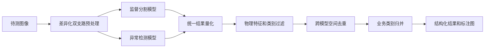
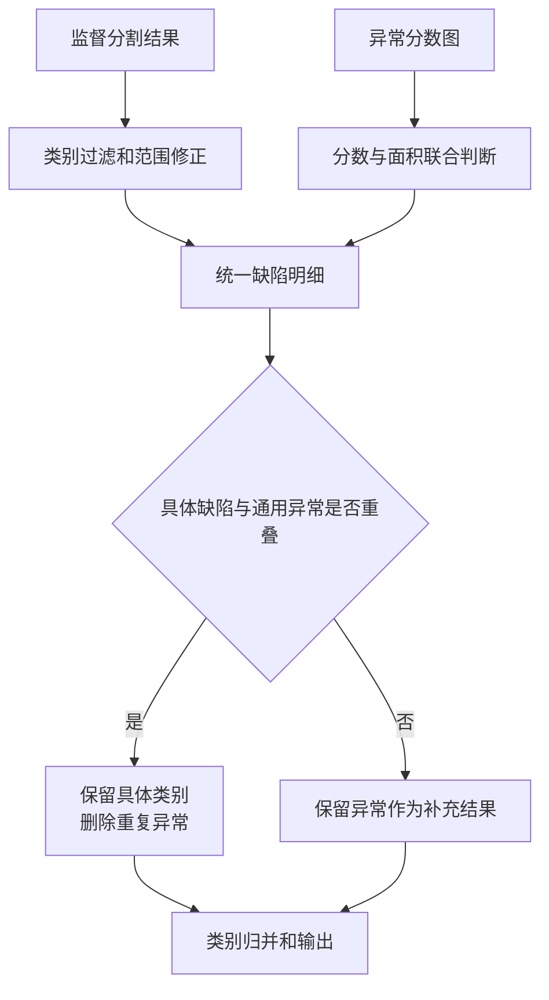

# 技术交底书

## 发明名称

一种融合监督分割与异常检测的工业缺陷协同检测方法及系统

# A 背景技术

工业外观检测通常采用两类方法。

一类是基于已标注缺陷样本训练监督模型，例如目标检测或实例分割模型。这类方法能够输出明确的缺陷类别和位置，但识别范围受训练样本和预设标签限制，对样本不足或未定义的新异常容易漏检。

另一类是基于正常样本建立特征库的异常检测方法。检测时，将待测图像特征与正常特征进行比较并生成异常分数图。这类方法可以发现偏离正常分布的区域，但通常只能输出通用异常，难以直接给出业务缺陷类别。

将两类模型直接并列运行仍存在以下问题：

1. 同一物理缺陷可能同时被监督模型和异常模型检出，造成重复计数；
2. 两个模型的输出形式不同，监督模型输出类别、检测框和掩膜，异常模型输出异常分数和异常图，无法直接融合；
3. 异常模型容易把无效边缘、黑边或固定结构判断为异常；
4. 单纯依靠模型分数难以排除反光、亮度不均和局部噪声；
5. 异常模型输出的整体异常区域不一定能满足缺陷分类、数量统计和工艺追溯要求。

因此，本方案要解决的重点不是简单增加第二个模型，而是使两类模型形成分工明确、结果可比较且不会重复报告的协同检测流程。

# B 发明内容及有益效果

## B.1 要解决的技术问题

本方案要解决以下技术问题：

1. 同时识别已知缺陷和训练标签以外的异常；
2. 将两类模型的异构输出转换为统一缺陷结果；
3. 消除两个模型对同一缺陷的重复报告；
4. 结合图像物理特征降低模型误报；
5. 将通用异常转换为客户端能够直接使用的分类结果。

## B.2 技术方案

本方法包括以下步骤：

1. 获取待测图像，并从同一待测图像生成第一模型输入和第二模型输入；其中，第一模型输入用于监督分割模型，第二模型输入用于异常检测模型，第二模型输入中的无效边缘区域被屏蔽；
2. 通过监督分割模型得到具有具体类别的第一检测结果，通过基于正常样本特征库的异常检测模型得到第二检测结果；
3. 将第一检测结果和第二检测结果统一转换为缺陷明细，每条缺陷明细至少包括缺陷区域、面积和对比度；
4. 根据缺陷类别对应的置信度、面积、尺寸和对比度条件过滤第一检测结果，并根据异常分数与异常面积的组合条件过滤第二检测结果；
5. 计算第二检测结果与第一检测结果之间的空间重叠关系；当两者满足重复条件时，删除通用异常结果，保留具有具体类别的监督分割结果；
6. 将保留结果映射为预设业务类别并输出。

## B.3 核心区别及效果

| 技术特征 | 解决的问题 | 技术效果 |
|---|---|---|
| 监督分割模型与正常样本异常模型分工检测 | 单一模型无法同时兼顾明确分类和未知异常 | 已知缺陷具有明确类别，未知异常得到补充 |
| 两个模型采用差异化预处理，异常支路屏蔽无效边缘 | 异常模型容易把黑边或无效视场识别为异常 | 在保留监督模型检测范围的同时降低异常模型边缘误报 |
| 将两种模型输出统一为区域、面积和对比度等缺陷明细 | 两种原始输出语义和尺度不同 | 为统一过滤、去重和统计提供基础 |
| 按空间重叠删除通用异常并保留具体类别 | 双模型对同一缺陷重复报告 | 避免重复计数，并优先保留信息量更高的结果 |
| 根据缺陷明暗极性计算对比度并参与过滤 | 单纯模型分数容易受照明和反光影响 | 利用缺陷与背景的实际灰度关系降低误报 |
| 异常分数与异常面积联合判定 | 单一异常阈值难以兼顾强小异常和大范围弱异常 | 同时覆盖不同尺度、不同强度的异常 |

本方案的核心在于“双模型结果如何协同”，而不在于具体使用哪一种模型、图像格式或软件接口。

## B.4 可以进一步采用的技术特征

1. 对指定类别在模型区域内执行种子提取、区域生长、形态学处理和连通域筛选，重新确定缺陷范围；
2. 对规则排列的多个异常连通域进行横向和纵向聚类，并根据数量及间距关系将整体异常拆分为多个单元异常；
3. 将模型内部细分类别通过配置归并为固定业务类别；
4. 两个模型交叠运行，并在其中一个模型失败时继续使用另一个模型的有效结果；
5. 结构化结果和标注图像使用同一份最终缺陷明细生成。

# C 具体实施例

## C.1 系统组成

系统包括图像预处理模块、监督分割模块、异常检测模块、结果量化模块、结果融合模块和结果输出模块。

图像预处理模块分别与监督分割模块和异常检测模块连接；两个模型的输出进入结果量化模块；结果量化模块与结果融合模块连接；结果融合模块完成过滤、去重和类别映射后，将最终缺陷明细发送至结果输出模块。

## C.2 处理过程

### 步骤一：双支路图像准备

输入为待测图像。系统将图像转换为两个模型要求的尺寸和通道格式。监督分割支路保留有效视场；异常检测支路检测并屏蔽无效边缘。

两个支路采用不同处理，是因为异常检测根据待测特征与正常特征分布之间的偏差判断异常，对黑边和无效视场更敏感；监督模型则可能仍需识别靠近边缘的已知缺陷。

输出为两路模型输入图像。

### 步骤二：执行监督分割和异常检测

监督分割模型输出缺陷类别、置信度、检测框和分割掩膜。异常检测模型从待测图像提取局部特征，与正常样本特征库进行近邻比较，形成异常分数图和图像级异常分数。

两个模型可以并行或异步交叠运行。两个模型均成功时进入融合；仅一个模型成功时使用该模型结果继续处理；所有模型均失败时返回检测失败。

### 步骤三：统一结果量化

对于监督分割结果，根据分割掩膜统计缺陷面积，并记录检测框和类别。对于异常检测结果，对异常分数图进行阈值化，去除图像缩放时的补边，将异常区域映射回原图，计算异常面积和外接框。

系统还根据缺陷掩膜和周围背景计算对比度。暗缺陷取偏暗像素统计，亮缺陷取偏亮像素统计，极性未知时根据缺陷相对背景的变化方向自动判断。背景值可以通过缺陷周围的环形区域以及中位数等稳健统计量确定。

经过量化后，两种模型结果均转换为至少包含类别、区域、面积、对比度和模型分数的缺陷明细。

### 步骤四：分别过滤两类结果

监督分割结果按类别分别设置启用状态、置信度阈值、对比度阈值、最小宽度、最小高度和最小面积。不同明暗极性的缺陷采用不同的对比度保留方向。

异常结果采用下式进行判定：

```text
保留异常 =
    异常分数达到第二阈值
    或
    异常分数达到第一阈值且异常面积比例达到面积阈值
```

第一种条件用于保留异常程度很高但面积较小的区域，第二种条件用于保留异常程度中等但覆盖范围较大的区域。

### 步骤五：跨模型去重

计算每个通用异常框与各监督分割框之间的交并比：

```text
IoU = 两区域交集面积 / 两区域并集面积
```

当任一交并比大于预设阈值时，认为两个结果对应同一物理缺陷，删除通用异常并保留具有具体类别的监督分割结果。未与任何具体缺陷重叠的异常结果继续保留，用于补充监督模型没有发现的异常。

去重在类别过滤之后执行，使已被判定为无效的监督结果不参与抑制；去重在最终计数之前执行，防止同一缺陷被重复统计。

### 步骤六：类别归并和输出

将保留结果的内部类别名称映射为业务类别。当前项目最终输出 `Abnormal`、`Stain`、`BrightClusters`、`GlueOverflow`、`Decolorization` 和 `LineArtifacts` 六类，但类别数量和映射关系均可调整。

输出可以包含各类别的缺陷数量，以及每个缺陷的面积、对比度和位置。当前工程通过固定数组和 Halcon 图像句柄输出；其他实现也可以使用结构体、共享内存、JSON 或图像对象。

## C.3 进一步实施方式

### 缺陷范围修正

当监督模型给出的缺陷框不能准确反映实际区域时，可以在框内估计局部背景，计算缺陷响应，通过严格阈值获得种子区域，再用较宽松阈值进行区域生长，经过形态学处理和连通域筛选后更新缺陷面积、框和对比度。修正结果不可靠时回退到模型原始结果。

### 规则阵列异常拆分

当异常二值图包含多个连通域时，选择主要连通域，并分别对中心横坐标和纵坐标聚类。以三行三列结构为例，检查每个横向分组和纵向分组是否均包含三个区域，并检查相邻行列间距是否近似一致。验证通过后，将整体异常拆分为九个单元异常；验证不通过时仍按整体异常输出。

### 当前工程接口

当前接口接收连续存放的单通道浮点图像数组，并输出六类缺陷数量、面积、对比度及可选 Halcon 图像句柄。该接口只是实施方式之一，不限制输入为浮点图像，也不限制输出类别数和数组形式。

## C.4 替代方案

1. 监督分割模型可以替换为其他目标检测、实例分割或语义分割模型；
2. 异常检测模型可以替换为其他基于正常样本、特征距离或重构误差的方法；
3. 跨模型去重可以采用框交并比、掩膜重叠率、中心距离或包含关系；
4. 对比度背景可以采用局部背景环、自适应局部平面或全视场统计；
5. 规则阵列可以是 M 行 N 列或其他具有空间先验的重复结构；
6. 输入可以是浮点图、整数灰度图、彩色图、相机缓冲区或图像文件；
7. 输出可以是数组、结构体、共享内存、数据库记录或其他结构化形式。

# D 附图

## 图1：系统架构图



## 图2：跨模型融合流程图



## 图3：规则阵列异常拆分示意图

```text
          列0              列1              列2
行0     [区域00]         [区域01]         [区域02]
行1     [区域10]         [区域11]         [区域12]
行2     [区域20]         [区域21]         [区域22]

连通域提取 → 横纵坐标聚类 → 数量及间距校验 → 单元异常输出
```

## 待补充材料

为说明实际效果，后续可补充以下真实数据：

1. 仅监督模型、仅异常模型和协同方案的漏检率、误检率或 F1 指标；
2. 跨模型去重前后的缺陷数量和标注图；
3. 对比度过滤或缺陷范围修正前后的结果；
4. 规则阵列异常拆分的实际样例。
